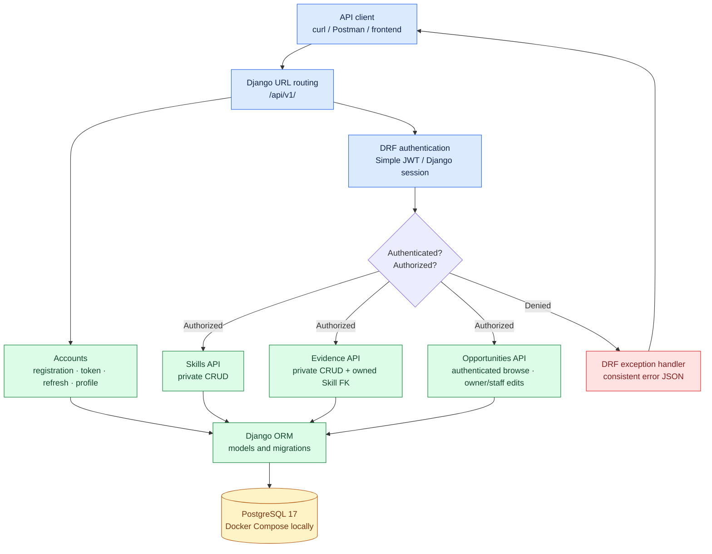

# SkillProof API — Architecture (Week 2)

**Purpose:** Mentor-ready overview of the implemented Django REST Framework API. All components shown as implemented reflect the Week 2 repository, not the planned Week 3 deployment.

## Request and security flow

## Key design decisions

1. **Django + DRF:** one backend with built-in authentication, serializers, and migrations.
2. **PostgreSQL:** relational foreign keys, a database constraint for case-insensitive per-owner Skill names, and cascades on related records.
3. **JWT:** 15-minute access and seven-day refresh tokens. Revocation and rotation are deferred hardening work.
4. **Ownership:** skills/evidence are private; opportunities are readable by authenticated users, but only the creator or `is_staff` administrator can change them.
5. **Error contract:** DRF-handled 400/401/403/404/405 errors have stable JSON codes; unexpected server failures are left to Django and must never expose debug details in production.
6. **Run mode:** Django on the host and PostgreSQL 17 in Docker Compose. Full app containerization, CI, OpenAPI, pagination, and deployment remain Week 3 work.

## Demonstration flow (5 minutes)

1. Introduce the problem: learners need one place for skills and supporting evidence.
2. Show the request flow diagram, then [the ERD](erd.md).
3. Register a dummy account, obtain a JWT, and call `GET /api/v1/auth/me/`.
4. Create a Skill, attach Evidence to it, and show the owner-only relationship.
5. Demonstrate Opportunity browsing and denied cross-user modification (403).
6. Show an invalid request returning a consistent error JSON; finish with the automated test results and known risks.

Do not share passwords, secret keys or real user data during the demonstration.
