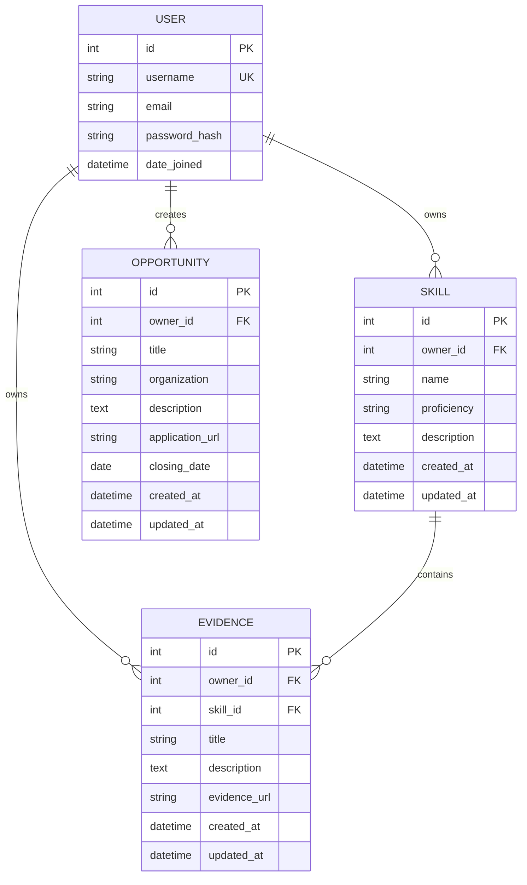

# SkillProof API — Entity Relationship Diagram

## Overview

This document describes the proposed database
relationships for the SkillProof API MVP.

The database contains four primary entities:

- User
- Skill
- Evidence
- Opportunity

## Entity Relationship Diagram

## Relationship Definitions

### User to Skill

Relationship: One-to-Many

A user can own multiple skills.
Each skill belongs to exactly one user.

Foreign Key:
Skill.owner_id -> User.id

Deletion:
CASCADE

### User to Evidence

Relationship: One-to-Many

A user can own multiple evidence records.
Each evidence record belongs to one user.

Foreign Key:
Evidence.owner_id -> User.id

Deletion:
CASCADE

### Skill to Evidence

Relationship: One-to-Many

A skill can have multiple evidence records.
Each evidence record references one skill.

Foreign Key:
Evidence.skill_id -> Skill.id

Deletion:
CASCADE

### User to Opportunity

Relationship: One-to-Many

A user can create multiple opportunities.
Each opportunity has one owner.

Foreign Key:
Opportunity.owner_id -> User.id

Deletion:
CASCADE

## Ownership Constraints

1. Skill ownership is assigned server-side.
2. Evidence ownership is assigned server-side.
3. Evidence.skill must belong to Evidence.owner.
4. Users cannot modify another user's skills.
5. Users cannot access another user's private evidence.
6. Only opportunity owners or authorized administrators
   can modify or delete opportunities.

## Database Design Notes

- Django's built-in User model is used.
- Primary keys use integer identifiers.
- Foreign keys enforce referential integrity.
- Related records use cascading deletion.
- Skill names will be normalized for uniqueness
  within each user's records.
- Evidence uses URLs instead of file uploads.
- Application validation enforces matching ownership.
- Database-level constraints will be added where
  practical during model implementation.

## Future Considerations

- Soft deletion instead of cascading deletion.
- Public skill portfolios.
- Opportunity filtering and searching.
- Additional indexes based on query performance.

These are outside the initial MVP scope.
