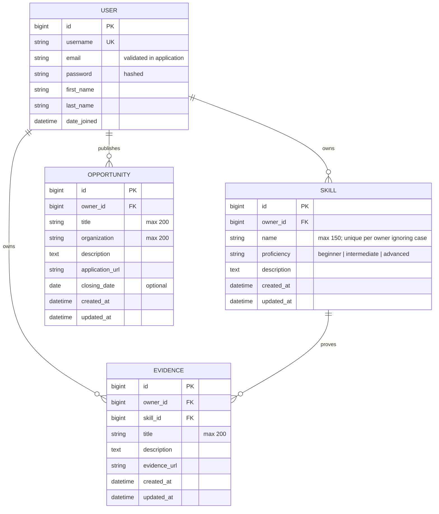

# SkillProof API — Week 2 Entity Relationship Diagram

The following Mermaid diagram depicts the **implemented** Django data models. It renders directly in GitHub Markdown and can be used in a mentor presentation.

## Relations and safeguards

| Relationship | Cardinality | Delete behavior | API rule |
| --- | --- | --- | --- |
| User → Skill | One-to-many | CASCADE | Owner-only list and detail operations |
| User → Evidence | One-to-many | CASCADE | Owner-only CRUD; client cannot override owner |
| Skill → Evidence | One-to-many | CASCADE | Evidence may reference only the owner's Skill |
| User → Opportunity | One-to-many | CASCADE | Authenticated read; owner/staff edit and delete |

**Important implementation details:** Email uniqueness is checked at the serializer level, not yet with a database unique constraint. Evidence `owner_id = skill.owner_id` is checked in model/serializer paths, not enforced as a cross-table database constraint. Both are recorded in the security review.

See [architecture.md](architecture.md) for the API flow and [week-2-security-review.md](week-2-security-review.md) for the six known risks.
